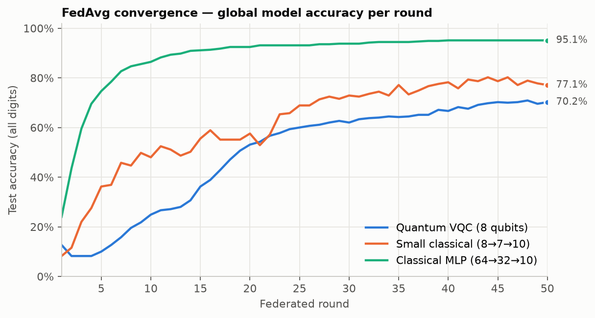
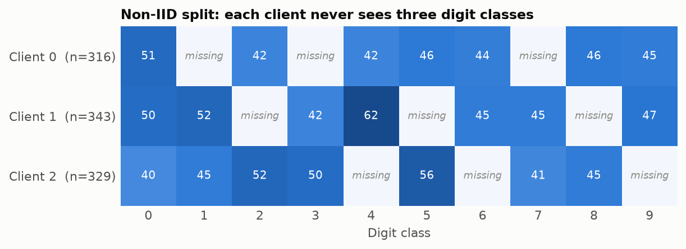
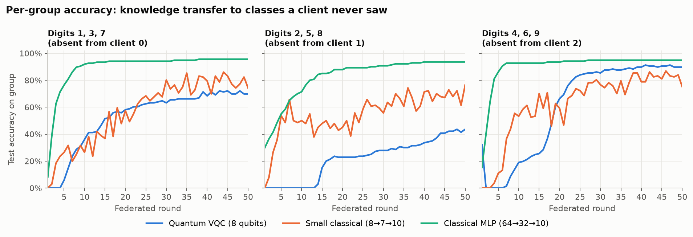
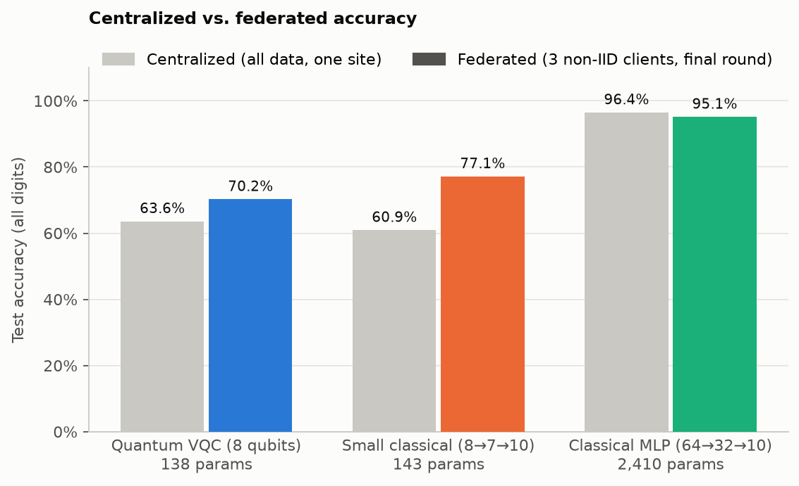
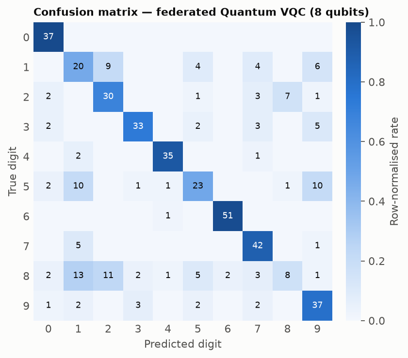

# QuantumFL — Quantum Federated Learning on Non-IID Data

A compact, from-scratch research testbed comparing a **variational quantum classifier (VQC)** against **classical neural networks** when trained with **Federated Averaging (FedAvg)** across clients whose local datasets are deliberately incomplete (*non-IID*: each client never sees three of the ten digit classes).

The project is intentionally small and readable: no FL framework, no hidden abstractions — a `Client`, a `fedavg` function, and a training loop you can read in one sitting.

<p align="center">
  
</p>

**Headline (50 FedAvg rounds, 3 non-IID clients):** the 138-parameter quantum classifier reaches **70.2 %** test accuracy, the parameter-matched classical network **77.1 %**, and the 2,410-parameter MLP **95.1 %**. All three models learn digit classes that individual clients never saw.

---

## Table of contents

- [Motivation](#motivation)
- [How it works](#how-it-works)
- [Models](#models)
- [Results](#results)
- [Project structure](#project-structure)
- [Installation](#installation)
- [Usage](#usage)
- [Reproducing the figures](#reproducing-the-figures)
- [Limitations & future work](#limitations--future-work)

---

## Motivation

Federated learning trains a shared model without moving raw data off the devices that own it. In practice, client data is rarely identically distributed: a hospital sees certain conditions, a phone sees its owner's handwriting. This project asks two questions:

1. **Can FedAvg recover classes that a client has never seen**, purely through aggregation with other clients?
2. **How does a parameter-matched quantum model behave** in that setting, compared with an equally small classical network and a larger classical baseline?

---

## How it works

### Dataset

[scikit-learn's handwritten digits](https://scikit-learn.org/stable/modules/generated/sklearn.datasets.load_digits.html) — 1,797 grayscale 8×8 images, 10 classes, split 75 / 25 into **1,347 train** and **450 test** samples (`random_state=0`).

Two preprocessing pipelines live in [qfl/data.py](qfl/data.py):

| Pipeline | Used by | Steps | Features |
|---|---|---|---:|
| `load_data()` | Classical MLP | `StandardScaler` | 64 |
| `load_quantum_data(n_qubits=8)` | Quantum VQC, small classical | `PCA(8)` → `MinMaxScaler(0, π)` | 8 |

The PCA pipeline compresses each image to 8 features scaled into `[0, π]`, so each feature can be used directly as a qubit rotation angle. The small classical model receives the **exact same 8 features**, making it a fair, parameter-matched baseline.

### Non-IID client split

`split_with_missing_digits()` shuffles the training set into equal shards (one per client) and then **removes a set of digit classes from each shard**:

| Client | Missing digits |
|---|---|
| 0 | 1, 3, 7 |
| 1 | 2, 5, 8 |
| 2 | 4, 6, 9 |

Every digit is present on *at least two* clients, but no single client can learn all ten classes on its own.



### Federated training loop

```
for each round:
    for each client:
        local_model = deepcopy(global_model)
        train local_model on the client's data   (SGD, cross-entropy, batch 16)
    global_model ← FedAvg(local_models, weighted by client dataset size)
    evaluate global_model on: all test digits, and each missing-digit group
```

- **Client** ([qfl/client.py](qfl/client.py)) — holds local tensors and runs mini-batch SGD on a deep copy of the global model.
- **Server** ([qfl/server.py](qfl/server.py)) — `fedavg()` computes the data-size-weighted average of every tensor in the clients' `state_dict`s; `accuracy()` evaluates a model.

Accuracy on each **digit group** is the key diagnostic: digits 1, 3, 7 are learned only from clients 1 and 2, so the global model's accuracy on that group measures how well knowledge transfers through aggregation.

---

## Models

All models are defined in [qfl/models.py](qfl/models.py).

### Quantum VQC — `make_quantum_model(n_qubits=8, n_layers=2)`

A hybrid quantum–classical network built with [PennyLane](https://pennylane.ai/) and exposed to PyTorch as a `TorchLayer`:

```
8 PCA features ──► AngleEmbedding (RX on 8 qubits)
               ──► StronglyEntanglingLayers × 2   (trainable: 2 × 8 × 3 = 48 weights)
               ──► ⟨Z⟩ on each qubit  → 8 expectation values
               ──► Linear(8 → 10)                 (trainable: 90 weights)
```

Simulated on `default.qubit` with `diff_method="backprop"`, so gradients flow end-to-end through the circuit. **138 trainable parameters.**

### Small classical — `make_small_classical(8, hidden=7, 10)`

`Linear(8→7) → ReLU → Linear(7→10)` on the same 8 PCA features. **143 parameters**, deliberately matched to the VQC.

### Classical MLP — `make_model()`

`Linear(64→32) → ReLU → Linear(32→10)` on the full 64-pixel input. **2,410 parameters** — an upper-bound reference for what the data supports.

---

## Results

All numbers below come from a single run of `python visualize.py` (50 rounds, seed 0) and are stored in [results/metrics.json](results/metrics.json).

| Model | Input | Params | Centralized | Federated (round 50) | Best federated round |
|---|---|---:|---:|---:|---:|
| Quantum VQC (8 qubits, 2 layers) | 8 PCA | 138 | 63.6 % | **70.2 %** | 70.9 % |
| Small classical (8→7→10) | 8 PCA | 143 | 60.9 % | **77.1 %** | 80.2 % |
| Classical MLP (64→32→10) | 64 pixels | 2,410 | 96.4 % | **95.1 %** | 95.1 % |

Accuracy on each client's **missing** digit group after round 50:

| Model | Digits 1, 3, 7 (absent from client 0) | Digits 2, 5, 8 (absent from client 1) | Digits 4, 6, 9 (absent from client 2) |
|---|---:|---:|---:|
| Quantum VQC | 69.9 % | 43.6 % | 89.8 % |
| Small classical | 74.3 % | 76.4 % | 75.2 % |
| Classical MLP | 95.6 % | 93.6 % | 94.9 % |

### Convergence of the global model


### Accuracy on each client's missing digits

Each panel tracks test accuracy on a digit group that **one client never sees**. Rising curves mean the aggregated model has learned those classes from the other clients.



### Centralized vs. federated

The grey bars train each model on the full training set at a single site (same epochs as the corresponding standalone script); the coloured bars show the federated model after the final round.



### Where the quantum model makes mistakes



### Key observations

- **FedAvg transfers knowledge across clients.** Every model reaches far above chance (10 %) on digits that one client never trains on, so aggregation alone lets the global model learn classes that are missing locally.
- **The 64-feature MLP is the clear upper bound.** It converges in about 15 rounds and ends within 1.3 points of its centralized accuracy. Most of the gap to the small models comes from the 8-component PCA bottleneck, not from federation.
- **Quantum vs. parameter-matched classical.** With about 140 parameters each on identical 8-feature inputs, the VQC trails the small classical network by about 7 points at round 50. Its learning curve is noticeably **smoother and more monotonic**, while the classical network fluctuates by ±5 points from round to round.
- **The quantum model starts slowly.** It stays near chance for the first 5 rounds and learns the 2, 5, 8 group last (0 % until round 14). The confusion matrix shows digits **8** and **5** as its weakest classes, often misread as 1, 2 or 9.
- **Federated beats centralized for the small models. This is a budget effect, not a federation benefit.** The centralized scripts train for 20 epochs, but 50 FL rounds × 2 local epochs give each client about 100 epochs of updates. For a matched comparison, raise the epochs in `quantumCentralized.py` / `classicalSmall.py`.

---

## Project structure

```
quantumFL/
├── qfl/                     # core library
│   ├── data.py              # dataset loading, PCA encoding, non-IID splitting
│   ├── models.py            # quantum VQC, small classical net, MLP
│   ├── client.py            # Client: local SGD training
│   └── server.py            # fedavg() aggregation, accuracy()
│
├── run.py                   # FL with the 64-feature MLP (20 rounds)
├── runCompare.py            # FL with quantum OR small classical (set MODEL=...)
├── centralized.py           # centralized MLP baseline (40 epochs)
├── quantumCentralized.py    # centralized quantum baseline (20 epochs)
├── classicalSmall.py        # centralized small-classical baseline (20 epochs)
├── make_clients.py          # inspect per-client class counts (5-client example)
├── check_model.py           # sanity check of model output shape
│
├── visualize.py             # runs all experiments and renders the figures below
├── results/                 # generated figures + metrics.json
└── requirements.txt
```

---

## Installation

Requires **Python 3.11** (tested with PyTorch 2.x and PennyLane 0.45).

```bash
git clone <repo-url> quantumFL
cd quantumFL

conda create -n qfl python=3.11 -y
conda activate qfl
pip install -r requirements.txt
```

> `requirements.txt` also lists optional packages (Qiskit, Flower, torchvision, Jupyter) for future extensions. The minimal set needed to run everything here is:
> `pip install torch pennylane scikit-learn numpy matplotlib`

---

## Usage

All scripts are run from the repository root.

```bash
# Federated learning — classical MLP on 64 features
python run.py

# Federated learning — quantum vs. small classical
# (edit MODEL = "quantum" | "classical" and ROUNDS at the top of the file)
python runCompare.py

# Centralized baselines
python centralized.py          # MLP
python quantumCentralized.py   # quantum VQC
python classicalSmall.py       # small classical

# Utilities
python make_clients.py         # print per-client digit counts
python check_model.py          # verify output shape
```

Example output of `runCompare.py`:

```
model: quantum | params: 138
round 1 | all 0.082 | 137 0.000 | 258 0.000 | 469 0.000
...
```

---

## Reproducing the figures

[visualize.py](visualize.py) runs every experiment (all three models, federated and centralized) with the same hyper-parameters as the scripts above, then writes the figures and a `metrics.json` to `results/`.

```bash
python visualize.py               # full run, 50 federated rounds (~4 min on CPU)
python visualize.py --rounds 20   # quicker run
python visualize.py --plot-only   # re-draw figures from results/metrics.json
```

| Setting | Quantum VQC | Small classical | Classical MLP |
|---|---|---|---|
| Features | 8 (PCA) | 8 (PCA) | 64 (raw, standardized) |
| FL local epochs / lr | 2 / 0.1 | 2 / 0.1 | 3 / 0.01 |
| Centralized epochs / lr | 20 / 0.1 | 20 / 0.1 | 40 / 0.01 |
| Optimizer / batch size | SGD / 16 | SGD / 16 | SGD / 16 |
| Seed | `torch.manual_seed(0)` | `torch.manual_seed(0)` | `torch.manual_seed(0)` |

Quantum circuits are simulated exactly on CPU: one federated round of the VQC takes about 3.5 s, and the classical models take under 0.1 s per round.

---

## Limitations & future work

- **Simulation only.** The circuit runs on a noiseless state-vector simulator; results on real hardware will differ because of shot noise and decoherence.
- **Small dataset.** 8×8 digits keep the qubit count tractable but are far simpler than real-world FL workloads.
- **Plain FedAvg.** Algorithms designed for non-IID data (FedProx, SCAFFOLD, FedNova) are natural next steps.
- **Single seed.** Reported numbers come from one run; averaging over several seeds would give confidence intervals.
- **Possible extensions:** deeper or data-re-uploading circuits, more qubits / PCA components, Qiskit / hardware back-ends, Flower-based deployment, and differential-privacy noise on client updates.

---

## License

No license file is included yet. Add one (e.g. MIT) before publishing or accepting contributions.
